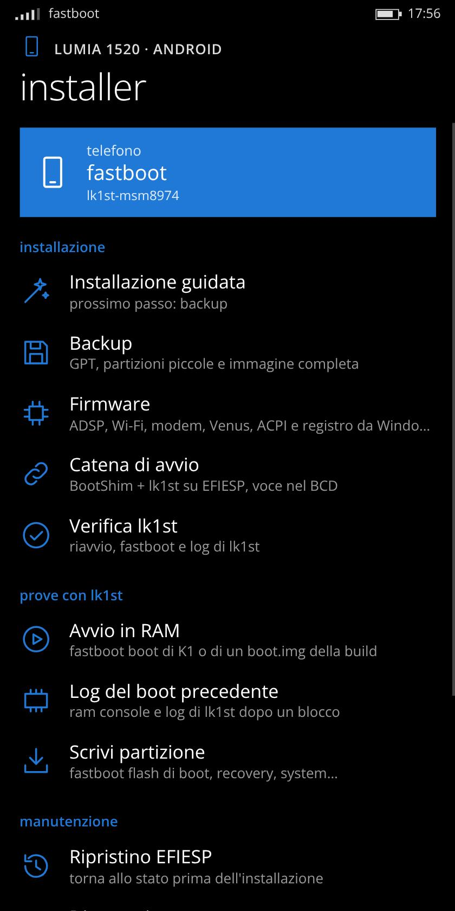
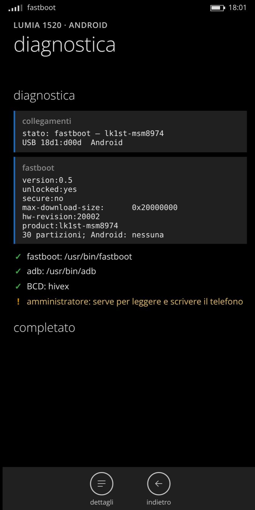
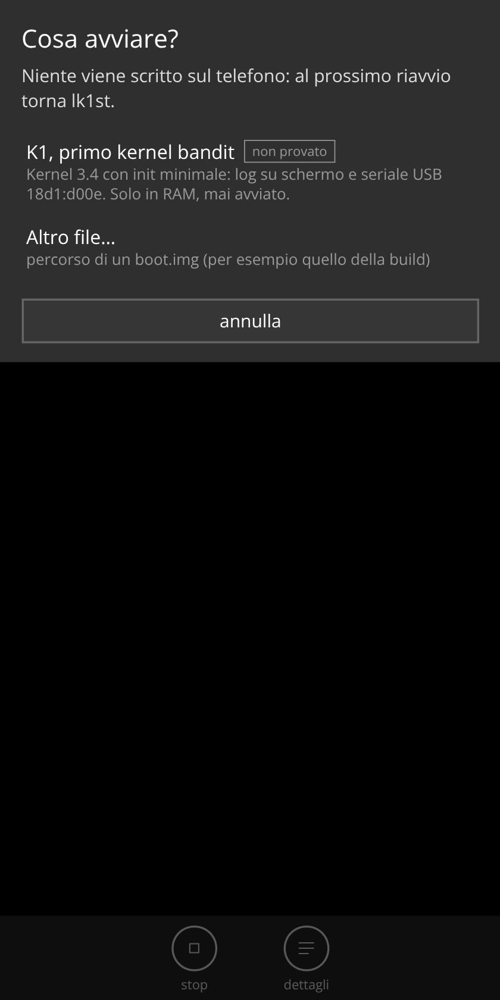

# Lumia 1520 Android installer (bandit)

An installer for running Android on the Nokia Lumia 1520 (RM-937/RM-938/RM-940, codename
**bandit**), for **Windows and Linux**, with a desktop app window in the style of Windows 10. The interface is in English, with Italian
available in the settings or with `--lang it`.

It sets up the boot chain that starts Android from the phone's own Windows Phone boot manager:

```text
UEFI Nokia → bootmgr → BCD entry "Android (lk1st)" → BootShim → lk1st (fastboot)
```

and then works through that chain: it boots test kernels in RAM, writes Android partitions with
fastboot and collects the logs. **Experimental**: the work on the Android port is in progress.

<p>



</p>

<sub>Screenshots taken with the Italian interface on a real RM-937 in lk1st fastboot.</sub>

## Modes

As in the [Lumia 950 XL installer](https://github.com/giannoccarol/installer-cityman-a16), you pick one
of three modes and the installer goes through the steps in order, resuming where it stopped.

| Mode | Phone before | What happens | Data |
|---|---|---|---|
| **Full** | Windows 10 Mobile, unlocked with WPinternals, in mass storage mode | Backup, firmware from Windows, BootShim + lk1st on EFIESP, restart and lk1st check in fastboot; then, optionally, the K1 test kernel in RAM | Windows stays intact (for now) |
| **Clean** | lk1st and Android partitions already in place | TWRP, format data, ROM | All Android data erased |
| **Update** | This ROM already installed | TWRP, ROM | Kept |

Today only **Full** is available, and it stops at lk1st in fastboot. Clean, Update and the part of Full
that replaces Windows with the Android partitions are shown but disabled until the partition layout is
final and a ROM boots on the phone (phase 2).

## Advanced tools

The single steps are also available on their own, for development and recovery:

| Task | Phone mode | Writes to the phone |
|---|---|---|
| **Backup** | mass storage | no: GPT, every partition under 512 MiB (read twice and compared), optional full compressed image, SHA-256 list |
| **Firmware** | mass storage | no: ADSP/WCNSS/modem/Venus firmware, audio and Wi-Fi calibration, ACPI tables and registry from Windows; `.mbn` split into `.mdt` + `.bNN` |
| **Boot chain** | mass storage | EFIESP only: BootShim, lk1st and a BCD entry, after a backup of EFIESP (files and raw image) |
| **Check lk1st** | restart → fastboot | no: waits for lk1st, explains what it sees on the way (boot manager, Qualcomm 9008…), saves `getvar all` and the lk1st log |
| **Boot in RAM** | fastboot | no: `fastboot boot` of the K1 test kernel or of a `boot.img` from a build, then watches USB (serial log capture on Linux) |
| **Previous boot log** | fastboot | no: ram console (ramoops) and lk1st log after a hang |
| **Write partition** | fastboot | yes: `fastboot flash` of Android partitions only (`boot`, `recovery`, `system`…), never Windows or Qualcomm ones |
| **Restore EFIESP** | mass storage | yes: back to a backup, by files (Windows and Linux) or whole image (Linux) |
| **Diagnostics** | any | no |

## Safety

- Holding **volume up** at power-on opens flash mode, the way back with WPinternals. The installer
  refuses any BCD that would change that action.
- The BCD is never copied from another phone: the new entry takes the EFIESP device element from an
  entry already on the same partition (Reset My Phone or Mobile Startup).
- The new BCD is written next to the backup first, read back with an independent parser and checked
  against the plan (one BootShim entry, same device, other entries unchanged, flash-mode action
  intact). Only then is it copied to the phone, and every written file is compared with the kit.
- Every destructive step asks you to type a word (`INSTALL`, `WRITE`, `RESTORE`).
- The kit files have pinned SHA-256 hashes ([`payload/payload.json`](payload/payload.json)).
- The local app window is served on `127.0.0.1` only, on a random port, with a random token
  required on every request.

## Requirements

- The phone **unlocked with [WPinternals](https://github.com/ReneLergner/WPinternals)** (needs a
  Windows PC). WPinternals also switches it to mass storage mode. After unlocking you may move the
  cable to a Linux PC: the phone stays in mass storage mode until it restarts.
- **Python 3.8 or newer**, standard library only.
  Windows: [python.org](https://www.python.org/downloads/windows/) or `winget install Python.Python.3.12`.
- **Android Platform Tools** (`fastboot`, `adb`): the installer can download Google's copy into `tools/`.
- Windows: the [Google USB driver](https://developer.android.com/studio/run/win-usb) for fastboot.
  The BCD is changed with Windows' own `bcdedit`.
- Linux: `python3-hivex` for the BCD (Arch `hivex`, Debian/Ubuntu `python3-hivex`, Fedora
  `python3-hivex`), `util-linux`, `ntfs3` or `ntfs-3g` for the firmware step.
- For the app window: Edge or Chrome on Windows, Chromium/Chrome/Brave/Edge on Linux (otherwise the
  default browser opens a tab).

## Usage

```bash
./installer.sh            # Linux (asks for sudo)
```

```bat
installer.bat             :: Windows (asks for administrator rights)
```

| Option | Meaning |
|---|---|
| `--mode full\|clean\|update` | start that mode without the menu |
| `--lang en\|it` | interface language (default: English, or the one last chosen in the settings) |
| `--text` | terminal interface, for SSH or machines without a browser |
| `--text --action <task>` | run one task and exit (`backup`, `chain`, `verify`, `boot`, `diag`…) |
| `--text --mode full` | run the full install in the terminal and exit |
| `--work <folder>` | backups, logs and progress (default `work/` next to the installer) |
| `--no-browser` | only print the address of the app window |
| `--no-elevate` | do not ask for administrator/root rights (fastboot tasks only) |

Everything the installer saves goes to `work/`: `backups/`, `private/` (firmware), `logs/` and
`state.json` (progress, used by the guided install). Backups and firmware contain personal data and
Nokia/Microsoft files: **do not publish them**.

### Restore

- From the installer: **Restore EFIESP**, with the phone in mass storage mode.
- Linux by hand, with the partition unmounted and the device name checked twice:
  `dd if=work/backups/efiesp-<date>/efiesp-partition.img of=/dev/sdX25 bs=1M conv=fsync`.
- Windows by hand: write `efiesp-partition.img` to EFIESP with Win32DiskImager.
- If the phone does not start at all: volume up at power-on, then WPinternals or Windows Device
  Recovery Tool.

## Status

| Part | State |
|---|---|
| BootShim `elf-loader-pre3` + lk1st `base-0ff` | fastboot verified on an RM-937 (2026-11-01) |
| Linux BCD writer (hivex) | output byte-identical to the kit script used on the phone |
| Windows BCD writer (bcdedit) | written, **not yet run on Windows**; its output goes through the same checks |
| Windows disk, volume and USB detection | written, **not yet run on Windows** |
| Web interface and fastboot tasks | run against the real phone in lk1st (read-only tasks) |
| K1 test kernel | **never booted** |

## Layout

```text
installer.py, installer.sh, installer.bat   entry points
bandit_installer/
  app.py       arguments, privileges, text interface
  web.py       local server and app window
  web/         the interface (one HTML file)
  steps.py     the tasks
  bcd.py       BCD plan, writers (hivex, bcdedit) and checks
  regf.py      read-only registry hive parser
  gpt.py       GPT parser (the phone's partitions are always read from its GPT)
  images.py    BootShim ELF checks, boot image header, PIL firmware split
  phone.py     phone mode from USB ids, fastboot and adb
  sysdeps.py   Linux and Windows specifics
payload/       BootShim, lk1st, K1 and their pinned hashes
```

## Credits

- **imbushuo (Bingxing Wang)**: [boot-shim](https://github.com/imbushuo/boot-shim), release
  `elf-loader-pre3` (ARM32), the UEFI application that loads lk1st. Included unmodified.
- **msm8916-mainline**: [lk2nd](https://github.com/msm8916-mainline/lk2nd), base of lk1st; bandit port in
  [giannoccarol/lk2nd](https://github.com/giannoccarol/lk2nd) (branch `bandit`).
- **KorelisLabs**: [lumia-1520-mainline](https://github.com/KorelisLabs/lumia-1520-mainline): 1520 boot
  chain, lk1st device tree and load address, and the PIL split format reproduced in `images.py`.
- **Markynose**: BootShim → lk1st chain on the Lumia 930.
- **René Lergner (HeathCliff)**: [WPinternals](https://github.com/ReneLergner/WPinternals), unlock and
  mass storage mode.
- **Android4Lumia950** (djokcho, EpicLPer, j0sh1x, sonic011gamer and the community): the
  [Lumia 950/950 XL installer](https://github.com/Android4Lumia950/installer) and BCD this one takes as
  its model.
- **LineageOS** and the `oppo_msm8974` kernel the bandit kernel is based on.
- Google for the Android Platform Tools and USB driver.

---

## In italiano

Installer per Android sul Lumia 1520, per Windows e Linux, con interfaccia in stile Windows 10
Mobile (si apre come finestra app; `--text` per il terminale). Prepara la catena di avvio
BootShim → lk1st da EFIESP con backup e verifiche, poi avvia kernel di prova in RAM, scrive le
partizioni Android con fastboot e raccoglie i log. Serve il telefono sbloccato con WPinternals.
Avvio: `./installer.sh` su Linux, `installer.bat` su Windows. Il volume su all'accensione resta
sempre la modalità flash per il recupero.
